# Aula 1: CRUD com Spring Boot


> **Síntese da aula:** nesta primeira aula, desenvolveremos uma API de produtos com Spring Boot, implementando as operações de criação, consulta, atualização e exclusão (CRUD). Criaremos o projeto pelo Spring Initializr, configuraremos o banco H2 e organizaremos o código em entidade, repositório, serviço e controlador. Utilizaremos Spring Data JPA para persistência e Lombok para reduzir código repetitivo. Por fim, testaremos as operações no Postman e consultaremos os dados pelo console H2, compreendendo o fluxo entre a requisição HTTP, as camadas da aplicação e o banco de dados. Essa implementação introdutória será aprimorada nas próximas aulas.


### Proposta de aprendizagem

Ao concluir o roteiro, você deverá conseguir explicar como o Spring cria e conecta os componentes, como uma entidade é persistida, como uma requisição se transforma em chamada Java e como verificar o resultado pela API e pelo banco de dados.

**Percurso de uma requisição:** o cliente envia HTTP; o controlador recebe e converte os dados; o serviço coordena a operação; o repositório acessa a persistência; o resultado volta ao cliente como resposta HTTP. Cada camada possui uma responsabilidade reconhecível, mesmo nesta versão pequena.

## Parte 1️⃣: 🚀 Criando o projeto no Spring Initializr

**Objetivo**: Criar um projeto Spring Boot com H2 Database para um CRUD da tabela de produtos.<br>
CRUD é um acrônimo que significa **Create, Read, Update e Delete**, que são as quatro operações básicas de manipulação de dados em um banco de dados.

1. **Acesse o Spring Initializr**:

    - [Spring Initializr](https://start.spring.io)
    
        ```bash
            https://start.spring.io
        ```

    **O que o Initializr faz?** Ele gera a estrutura inicial, o descritor de dependências e a classe de inicialização. Spring Framework fornece recursos como o contêiner de objetos e a injeção de dependência; Spring Boot simplifica sua configuração e execução por meio de convenções, autoconfiguração e dependências agrupadas. A geração do projeto prepara o ambiente, mas as operações de negócio serão implementadas por nós. [1, 2]

2. **Configure o projeto**:

   * **Project**: Maven
   * **Language**: Java
   * **Spring Boot**: 3.5.4 (ou a versão mais recente)

   **Maven e construção do projeto.** O Maven lê o `pom.xml`, resolve bibliotecas e dependências transitivas e executa etapas como compilação, testes e empacotamento. Um *starter* reúne dependências para uma finalidade; o gerenciamento de versões do Spring Boot procura manter esse conjunto compatível. A JVM executa a aplicação; o JDK também inclui ferramentas de desenvolvimento, como o compilador.

   **Coerência de versões.** O roteiro original indica Java 25, mas o link preenchido abaixo solicita Java 21 e Spring Boot 3.5.4. Preserve a configuração adotada na aula e confira o `pom.xml`, o SDK do projeto e o JDK usado pelo Maven. Não interprete “versão mais recente” como garantia de compatibilidade com todos os exemplos. A versão exata do Boot, do JDK e dos processadores de anotações deve ser verificada em conjunto na documentação correspondente. [1, 2]

3. **Metadados**:

   * **Group**: `br.com.casasbahia`
   * **Artifact**: `crud-h2`
   * **Name**: `crud-h2`
   * **Package name**: `br.com.casasbahia.crud_h2`

   **Identidade do projeto.** `groupId` identifica a organização ou o agrupamento de artefatos; `artifactId` identifica o módulo. Junto com a versão, eles formam coordenadas usadas pelo Maven. O nome exibido do projeto não substitui o pacote Java. Pacotes seguem a convenção de domínio invertido e organizam tipos; hífen pode aparecer no nome de um artefato, mas não em um identificador de pacote Java.

4. **Packaging e Java**:

   * **Packaging**: Jar
   * **Java**: 25

5. **Dependências**:

   * Spring Web
   * Spring Data JPA
   * H2 Database
   * Lombok

   **Por que cada dependência foi escolhida?**

   | Dependência | Papel nesta aula | Distinção importante |
   | --- | --- | --- |
   | Spring Web | Processar requisições com Spring MVC, converter representações e executar a aplicação web com servidor embarcado | Não implementa sozinho as regras do produto |
   | Spring Data JPA | Disponibilizar a infraestrutura de repositórios e integração com JPA | JPA é a especificação; Hibernate é o provedor usado normalmente nesta configuração |
   | H2 Database | Disponibilizar um banco relacional e seu driver JDBC | Neste guia utilizamos o modo em memória; H2 também oferece outros modos |
   | Lombok | Gerar métodos e construtores durante a compilação | Atua sobre o código compilado; não é o contêiner de injeção de dependência |

   **Empacotamento JAR.** O projeto pode ser empacotado como um JAR executável pelo Spring Boot. O servidor embarcado permite executar a aplicação sem instalar e configurar separadamente um servidor de aplicações para esta aula. [1, 2]

6. **Link do Projeto**

    Segue o link para acessar o Spring Initializr com as configurações utilizadas nesse projeto já preenchidas:

    * **Spring Initializr com as configurações já preenchidas**: [Spring Initializr](https://start.spring.io/#!type=maven-project&language=java&platformVersion=4.1.2&packaging=jar&configurationFileFormat=yaml&jvmVersion=25&groupId=br.com.casasbahia&artifactId=crud-h2&packageName=br.com.casasbahia.crud-h2&dependencies=web,data-jpa,h2,lombok)


7. **Gerar o projeto**:

   * Clique em **Generate** e baixe o ZIP.

        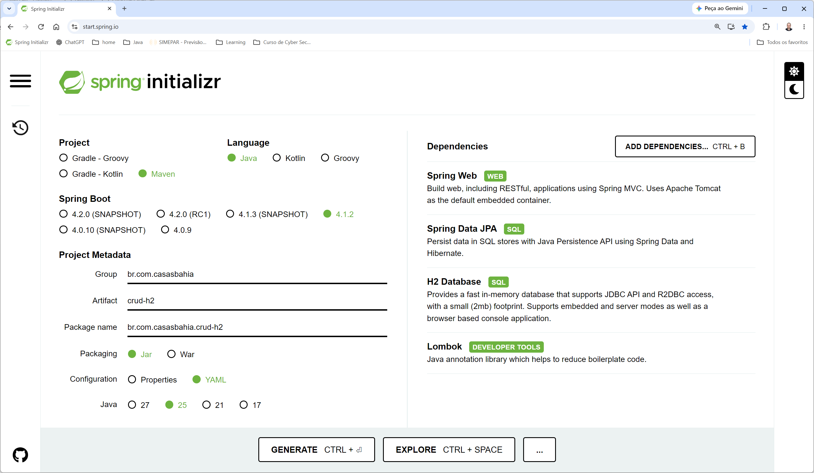


8. **Importe no IntelliJ IDEA**:

   * **File → Open...** → selecione a pasta descompactada.

   * Aguarde o download de dependências.


**Ao abrir no IntelliJ:** importe o projeto como Maven e aguarde a resolução das dependências. Erros de símbolos gerados pelo Lombok podem indicar configuração de processamento de anotações ou incompatibilidade de versões. Erros de compilação sobre `release` costumam exigir conferir o JDK e a configuração do Maven. Instalar uma biblioteca e configurar a IDE são ações diferentes.

---

## Parte 2️⃣: 📁 Estrutura do Projeto e Configuração

A estrutura do projeto gerado pelo Spring Initializr é organizada de forma a facilitar o desenvolvimento e a manutenção do código. 
Abaixo está uma visão geral da estrutura do projeto:
```
├── src
│   ├── main
│   │   ├── java
│   │   │   └── br
│   │   │       └── com
│   │   │           └── casasbahia
│   │   │               └── crud_h2
│   │   │                   └── CrudH2Application.java
│   │   └── resources
│   │       └── application.yaml
└── pom.xml
```

Durante o desenvolvimento da aula, vamos adicionar mais pastas e arquivos, como controladores, modelos, repositórios e serviços. 

### Como ler a estrutura

`src/main/java` contém o código Java; `src/main/resources` contém configurações e outros recursos incluídos no classpath. O `pom.xml` descreve a construção. A classe principal fica no pacote raiz para que os componentes nos subpacotes sejam encontrados pelas convenções do Spring Boot.

A segunda árvore original repete `CrudH2Application.java`: leia essa repetição como uma duplicidade na ilustração, e mantenha apenas a classe principal efetiva do projeto. As árvores foram preservadas como apresentadas na aula. [1, 2]

### 📦Organização dos Pacotes

Os pacotes são criados de acordo com as boas práticas de organização do código Java, seguindo a convenção de nomenclatura baseada no domínio da aplicação. 
No nosso caso, o pacote principal é `br.com.casasbahia.crud_h2`, que reflete o nome do projeto e a empresa. Dentro desse pacote, criaremos subpacotes para organizar melhor as diferentes camadas da aplicação, como `controller`, `model`, `repository` e `service`.

A estrutura do projeto é organizada para facilitar a navegação e a manutenção do código, seguindo os princípios de separação de responsabilidades.

Vamos criar os seguintes pacotes:
- `controller`: para os controladores REST, que gerenciam as requisições HTTP.
- `model`: para as entidades do domínio.
- `repository`: para os repositórios que interagem com o banco de dados.
- `service`: para os serviços que contêm a lógica de negócio.

A estrutura final do projeto ficará assim:

```
├── src
│   ├── main
│   │   ├── java
│   │   │   └── br
│   │   │       └── com
│   │   │           └── casasbahia
│   │   │               └── crud_h2
│   │   │                   ├── CrudH2Application.java
│   │   │                   ├── controller
│   │   │                   │   └── ProdutoController.java
│   │   │                   ├── model
│   │   │                   │   └── Produto.java
│   │   │                   ├── repository
│   │   │                   │   └── ProdutoRepository.java
│   │   │                   ├── service
│   │   │                   │    └── ProdutoService.java
│   │   │                   └── CrudH2Application.java
│   │   └── resources
│   │       └── application.yaml
└── pom.xml
```
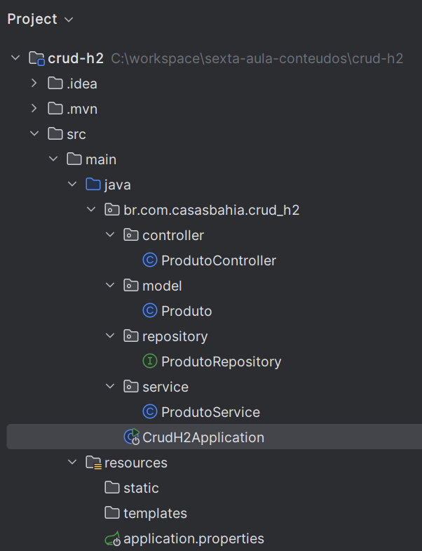


### ⚙️ Configuração do `application.yaml`

O arquivo `application.properties` ou `application.yaml` é utilizado para configurar diversas propriedades do Spring Boot, como a conexão com o banco de dados, o nome da aplicação, a porta do servidor, entre outras configurações específicas do ambiente.
No caso do H2 Database, ele permite definir a URL de conexão, o driver, as credenciais de acesso e outras propriedades relacionadas ao banco de dados.
O primeiro exemplo utiliza `application.properties`, com pares chave–valor. O segundo utiliza YAML, cuja hierarquia depende de indentação consistente com espaços. Considere os exemplos alternativas de configuração:

```properties
spring.application.name=crud-h2
server.port=8080

# Configuração da fonte de dados H2
spring.datasource.url=jdbc:h2:mem:produtosdb;DB_CLOSE_DELAY=-1;DB_CLOSE_ON_EXIT=FALSE
spring.datasource.driver-class-name=org.h2.Driver
spring.datasource.username=sa
spring.datasource.password=

# Dialeto e estratégia de criação de schema
spring.jpa.database-platform=org.hibernate.dialect.H2Dialect
spring.jpa.hibernate.ddl-auto=update

# Habilita o console web do H2
spring.h2.console.enabled=true
spring.h2.console.path=/h2-console

# (Opcional) Log SQL para facilitar desenvolvimento
spring.jpa.show-sql=true
spring.jpa.properties.hibernate.format_sql=true
```

Segue a alternativa em `application.yaml`, preservada conforme a aula. Observe a diferença no nome do banco, explicada após o exemplo:
```
spring:
  application:
    name: crud-h2

  # Configuração do datasource para o banco de dados H2
  datasource:
    url: jdbc:h2:mem:testdb
    driver-class-name: org.h2.Driver
    username: sa
    password: ""

  # Configuração do JPA e Hibernate
  jpa:
    show-sql: true # Log SQL para facilitar desenvolvimento
    properties:
      hibernate:
        format_sql: true
        use_sql_comments: true
    hibernate:
      ddl-auto: update

  # Configuração do console H2
  h2:
    console:
      enabled: true
      path: /h2-console
```


### Entendendo a configuração

| Propriedade ou recurso | Efeito e interpretação |
| --- | --- |
| `spring.application.name` | Identifica a aplicação; não define o nome do banco nem o endereço dos endpoints |
| `server.port` | No exemplo properties, define a porta 8080; na configuração web usual do Boot, essa também é a porta padrão |
| `spring.datasource.url` | Identifica o banco e o modo de conexão; `jdbc:h2:mem:` seleciona um banco H2 em memória |
| `driver-class-name` | Identifica a implementação do driver JDBC, que permite comunicação com o banco |
| `username` e `password` | Credenciais utilizadas pela conexão; nesta aula, `sa` e senha vazia |
| `spring.jpa.database-platform` | No properties, explicita o dialeto Hibernate; a identificação também pode ocorrer pelos metadados da conexão |
| `spring.jpa.hibernate.ddl-auto=update` | Solicita ao Hibernate atualização do esquema a partir dos mapeamentos; é uma conveniência didática, sem garantia de executar qualquer transformação estrutural |
| `show-sql` e `format_sql` | Exibem e formatam SQL para observação; não substituem testes nem validam os resultados |
| `use_sql_comments` | Solicita comentários no SQL gerado para auxiliar sua compreensão |
| `spring.h2.console.*` | Habilita o console web e define seu caminho; console e API têm funções diferentes |

**Atenção ao banco selecionado:** o properties usa `produtosdb`; o YAML usa `testdb`. São nomes de bancos diferentes. No console, use o nome presente na configuração efetivamente carregada: `jdbc:h2:mem:testdb` para o YAML ou `jdbc:h2:mem:produtosdb` para o properties. Os blocos originais foram mantidos.

No properties, `DB_CLOSE_DELAY=-1` mantém o banco em memória após o fechamento da última conexão enquanto a JVM estiver ativa, e `DB_CLOSE_ON_EXIT=FALSE` desabilita o fechamento automático por gancho de encerramento da JVM. Nenhuma dessas opções transforma memória em persistência em disco. Encerrar o processo elimina os dados desse modo de uso. [10]

**Configuração e evolução:** mantenha apenas a alternativa escolhida para evitar sobreposições difíceis de perceber. Em YAML, `datasource`, `jpa` e `h2` ficam dentro de `spring`, ao lado de `application`. `ddl-auto=update` não é um histórico de migrações; ferramentas como Flyway ou Liquibase serão uma evolução para mudanças versionadas de esquema. O console e as credenciais simplificadas pertencem ao ambiente didático local.

* **📚 SOLID**:  
  * **SOLID** é um conjunto de princípios que orienta a escrita de código limpo e de fácil manutenção.  

  * Aqui focamos no **Princípio da Responsabilidade Única (SRP – Single Responsibility Principle)**, que afirma que uma classe (ou módulo) deve ter **apenas um motivo para mudar**.

  * **Princípios e benefícios do SRP**:
    * **Organização clara**  
    * **Facilidade de alteração**  
    * **Reuso e manutenção**  

---


## Parte 3️⃣: 🛠️ Criando as Entidades, Repositórios, Serviços e Controladores

### 1. Classe CrudH2Application

```java
@SpringBootApplication
public class CrudH2Application {
    public static void main(String[] args) {
        SpringApplication.run(CrudH2Application.class, args);
    }
}
```
* **@SpringBootApplication**: anotação que habilita o Spring Boot e a varredura de componentes.
* **main**: ponto de entrada da aplicação.
* **SpringApplication.run**: inicia a aplicação Spring Boot.


### O que acontece na inicialização?

`@SpringBootApplication` reúne a configuração própria de aplicações Boot, a habilitação da autoconfiguração e a varredura de componentes. O contêiner registra e administra objetos chamados *beans*. A autoconfiguração considera classes disponíveis, propriedades e beans já definidos; não significa que toda configuração imaginável é criada automaticamente.

`SpringApplication.run` prepara o contexto e, em uma aplicação web como esta, inicia o servidor embarcado. O Spring encontra serviços e controladores por seus estereótipos e cria a infraestrutura dos repositórios por mecanismos específicos do Spring Data. Depois que o contexto termina de iniciar, as rotas podem receber requisições.

**Relação com SOLID:** esta classe concentra a inicialização. Isso favorece a separação de responsabilidades; a anotação, isoladamente, não comprova a aplicação de todos os princípios. **Leitura:** Walls e Spilcă [1, 2].

### 2. Entidade `Produto` (Model)

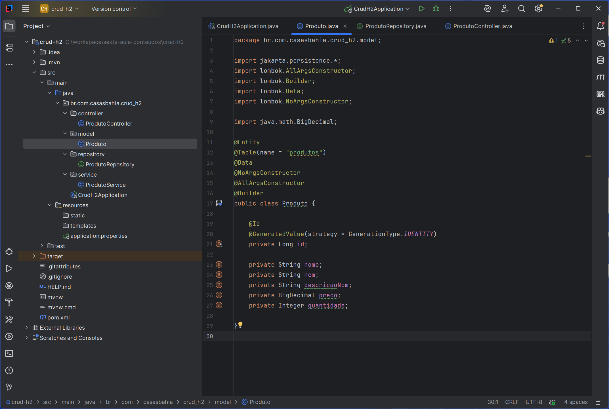

```java
@Entity
@Table(name = "produtos")
@Data
@NoArgsConstructor
@AllArgsConstructor
@Builder
public class Produto {

    @Id
    @GeneratedValue(strategy = GenerationType.IDENTITY)
    private Long id;

    private String nome;
    private String ncm;
    private String descricaoNcm;
    private BigDecimal preco;
    private Integer quantidade;
}
```

Podemos ver na implementação da classe `Produto` anotações do Lombok que ajudam a reduzir o boilerplate de código, a saber:
* `@Data`: gera getters, setters, `toString`, `equals` e `hashCode`.
* `@Builder`: permite criar instâncias da classe usando o padrão Builder.
    * 📚 **Padrão Builder**:
        * **Padrão Builder**: é um padrão de design que facilita a criação de objetos complexos, permitindo a construção passo a passo.
        * **Vantagens**:
            * Melhora a legibilidade do código.
            * Facilita a criação de objetos com muitos parâmetros.
            * Pode participar da construção de objetos imutáveis, mas não garante imutabilidade; `Produto` possui setters nesta aula.
        * **Benefícios**: código mais limpo, fácil de entender e manter.
* `@NoArgsConstructor`: cria um construtor sem argumentos.
* `@AllArgsConstructor`: cria um construtor com todos os argumentos.

* **📚 Conceitos => Lombok**:
    * **Lombok** é uma biblioteca Java que reduz o boilerplate de código, gerando automaticamente métodos comuns como getters, setters, construtores e `toString`.
    * **Vantagens do Lombok**:
        * Redução de código repetitivo.
        * Melhoria na legibilidade.
        * Facilita a manutenção do código.  
    * **Benefícios**: menos boilerplate, código mais limpo.


A classe `Produto` também possui anotações JPA:
* `@Entity`: indica que a classe é uma entidade persistente no banco de dados.
* `@Table(name = "produtos")`: explicita o nome da tabela. Sem essa definição, o nome resulta das regras de mapeamento e das estratégias de nomenclatura configuradas; não se resume obrigatoriamente ao nome da classe em minúsculas.
* `@Id`: indica que o campo `id` é a chave primária da entidade.
* `@GeneratedValue(strategy = GenerationType.IDENTITY)`: indica que o valor do campo `id` será gerado automaticamente pelo banco de dados, usando a estratégia de identidade (auto incremento).


### Mapeamento e tipos da entidade

Uma entidade é um objeto com identidade persistente, associado a uma tabela por mapeamento objeto-relacional (ORM). Seus atributos representam o estado; isso não significa que o objeto e uma linha do banco sejam a mesma coisa. JPA é hoje Jakarta Persistence, mantendo-se amplamente o nome JPA. No Spring Boot 3, as APIs de persistência usam o namespace `jakarta.persistence`.

`Long` permite que o ID seja inicialmente `null`; `IDENTITY` delega sua geração ao mecanismo de identidade do banco. Como `@Id` está no campo, o mapeamento utiliza acesso aos campos. `BigDecimal` representa valores decimais com precisão arbitrária, adequado para discutir dinheiro, mas escala, arredondamento e regras monetárias continuam sendo decisões explícitas. `Integer` admite ausência de valor e não impede quantidades negativas. O NCM é representado como texto; o exemplo não verifica sua validade fiscal.

**O que as anotações não fazem:** `@Entity` não valida o preço, o nome ou a quantidade. `@Builder` facilita a montagem, mas não garante um objeto válido e não equivale integralmente à estrutura do Builder descrita pelo GoF. `@NoArgsConstructor` atende ao requisito de construção sem argumentos da entidade. `@Data` gera comportamento com base nos campos; igualdade, hash e `toString` merecem revisão em entidades, sobretudo quando surgirem associações e campos mutáveis. [3, 5, 6, 11]

**Responsabilidade nesta versão:** `Produto` representa os dados persistidos e também será utilizado na entrada e na saída HTTP. Essa simplificação reduz os tipos necessários à introdução; DTOs e validação serão oportunidades para separar o contrato da API do modelo de persistência. **Leitura:** Bloch para objetos e igualdade; Bauer, King e Gregory para persistência [3, 6].

### 3. Repositório `ProdutoRepository`

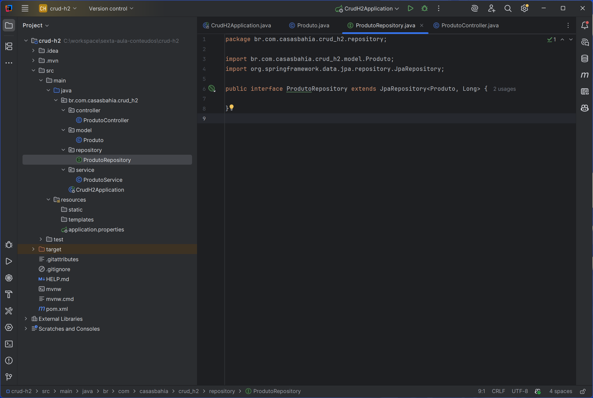

```java
public interface ProdutoRepository extends JpaRepository<Produto, Long> {

}
```

* **Estende `JpaRepository<Produto, Long>`**: herda contratos de operações de persistência; os parâmetros genéricos informam o tipo da entidade e o tipo de seu identificador.

* **📚 Conceitos => Interface**:

    * **Interface**: define um contrato que as classes implementadoras devem seguir.
    * **Vantagens**:
        * Promove a abstração e desacoplamento.
        * Permite múltiplas implementações.
        * Facilita testes unitários com mocks.

* **📚 Repository Pattern**:

    * **Repository Pattern**: é um padrão de design que separa a lógica de acesso a dados da lógica de negócio.
    * **Vantagens**:
        * Promove a organização do código.
        * Facilita a manutenção e testes.
        * Reduz o contato da lógica de negócio com detalhes de acesso a dados; uma troca de persistência ainda pode exigir adaptações em mapeamentos, consultas e comportamento transacional.
    * **Benefícios**: código mais limpo, fácil de entender e manter.


### Por que uma interface sem implementação escrita funciona?

O Spring Data cria um proxy que encaminha chamadas para a infraestrutura de repositórios e para a implementação de operações JPA. A interface vazia já herda métodos como `save`, `findAll`, `findById`, `existsById` e `deleteById`. `findById` devolve `Optional<Produto>`, deixando explícito que uma consulta pode não encontrar resultado.

`save` não significa sempre executar um INSERT: o Spring Data decide entre `persist` e `merge` conforme a identificação de uma entidade nova. SQL e sincronização com o banco dependem também do contexto de persistência e das transações. Utilize o objeto retornado por `save`, como faz o exemplo. [9]

**Princípios e limites:** a interface permite ao serviço depender de um contrato, favorecendo DIP em relação à implementação concreta. Entretanto, `JpaRepository` ainda é um contrato do framework; esta aula não demonstra independência completa do domínio. Sua API ampla também não demonstra ISP apenas por ser uma interface. Repository, em Fowler, trata da mediação entre domínio e mapeamento de dados; o Spring Data oferece uma realização prática com características próprias. **Leitura:** Fowler [4] e documentação Spring Data [9].

### 4. Serviço `ProdutoService`

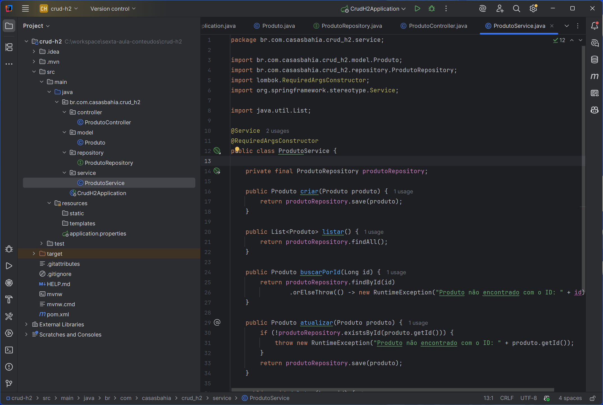

```java
@Service
@RequiredArgsConstructor
public class ProdutoService {

    private final ProdutoRepository produtoRepository;

    public Produto criar(Produto produto) {
        return produtoRepository.save(produto);
    }

    public List<Produto> listar() {
        return produtoRepository.findAll();
    }

    public Produto buscarPorId(Long id) {
        return produtoRepository.findById(id)
            .orElseThrow(() -> new RuntimeException("Produto não encontrado com o ID: " + id));
    }

    public Produto atualizar(Produto produto) {
        if (!produtoRepository.existsById(produto.getId())) {
            throw new RuntimeException("Produto não encontrado com o ID: " + produto.getId());
        }
        return produtoRepository.save(produto);
    }

    public void deletar(Long id) {
        if (!produtoRepository.existsById(id)) {
            throw new RuntimeException("Produto não encontrado com o ID: " + id);
        }
        produtoRepository.deleteById(id);
    }
}
```

* **@Service**: anotação que indica que a classe é um serviço Spring.
* **@RequiredArgsConstructor**: gera um construtor para campos `final` não inicializados e campos `@NonNull` que precisam de inicialização. Neste exemplo, disponibiliza a dependência pelo construtor.
* **Métodos CRUD**: implementa métodos para criar, listar, buscar por ID, atualizar e deletar produtos.

* **📚 Serviços**:
    * **Serviços**: classes que contêm a lógica de negócio da aplicação.
    * **Injeção de Dependência**: técnica que permite injetar dependências (como repositórios) em classes, promovendo o desacoplamento e facilitando testes unitários.
    * **Vantagens**:
        * Melhora a organização do código.
        * Facilita a manutenção e testes.
        * Promove o uso de princípios SOLID, como SRP (Single Responsibility Principle).


### Injeção de dependência e comportamento do serviço

O serviço recebe `ProdutoRepository` pelo construtor gerado pelo Lombok. O Spring fornece a instância gerenciada correspondente; com um único construtor, não é necessário explicitar `@Autowired`. O serviço deixa de criar seu próprio repositório, tornando a dependência visível e permitindo substituí-la em testes. `final` impede reatribuir a referência; não torna o objeto referenciado imutável.

| Método | Comportamento efetivamente implementado |
| --- | --- |
| `criar` | Encaminha o objeto a `save`; ainda não valida os dados nem impede ID informado pelo cliente |
| `listar` | Busca todos os registros; ainda não utiliza paginação |
| `buscarPorId` | Retorna o produto ou lança `RuntimeException` quando ausente |
| `atualizar` | Verifica existência pelo ID e encaminha o objeto a `save` |
| `deletar` | Verifica existência antes de excluir |

`orElseThrow` transforma a ausência do `Optional` em exceção. A expressão lambda fornece a exceção apenas quando necessária. A `RuntimeException` usada aqui não possui mapeamento explícito para HTTP 404: normalmente resultará em resposta de erro interno no tratamento padrão. Esse comportamento será aprimorado com exceções específicas e tratamento centralizado.

**Transações:** operações herdadas de repositório possuem configurações transacionais na infraestrutura Spring Data. Sem uma fronteira transacional no serviço, a combinação `existsById` seguida de escrita não forma, por si só, uma operação atômica. Outra requisição pode alterar o registro entre as chamadas; até uma transação exige discutir isolamento e concorrência para resolver isso corretamente.

**Relação com SOLID:** SRP aparece na concentração da coordenação das operações no serviço; a dependência da interface do repositório favorece DIP. Injeção de dependência é um mecanismo de construção; DIP é uma orientação sobre dependências e não são sinônimos. O serviço ainda é simples, preparando a localização de futuras regras de negócio. **Leitura:** Fowler, Martin e Spilcă [2, 4, 7].

### 5. Controlador `ProdutoController`

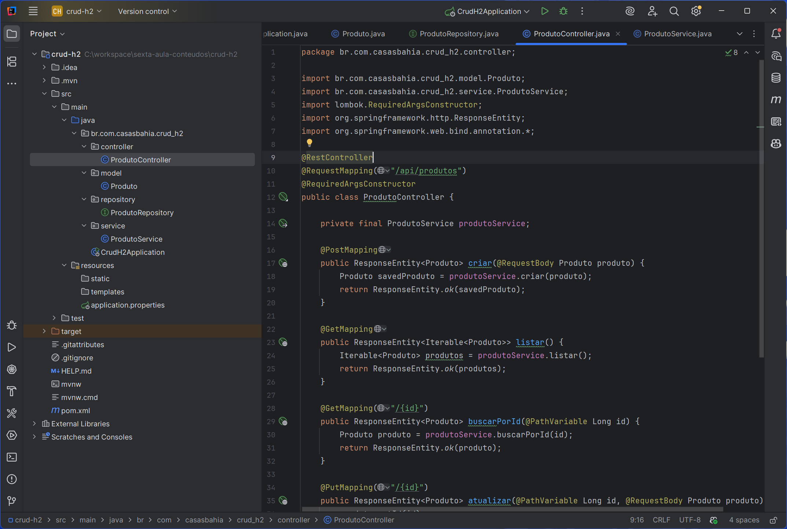

```java
@RestController
@RequestMapping("/api/produtos")
@RequiredArgsConstructor
public class ProdutoController {

    private final ProdutoService produtoService;

    @PostMapping
    public ResponseEntity<Produto> criar(@RequestBody Produto produto) {
        Produto saved = produtoService.criar(produto);
        return ResponseEntity.ok(saved);
    }

    @GetMapping
    public ResponseEntity<Iterable<Produto>> listar() {
        return ResponseEntity.ok(produtoService.listar());
    }

    @GetMapping("/{id}")
    public ResponseEntity<Produto> buscarPorId(@PathVariable Long id) {
        return ResponseEntity.ok(produtoService.buscarPorId(id));
    }

    @PutMapping("/{id}")
    public ResponseEntity<Produto> atualizar(@PathVariable Long id, @RequestBody Produto produto) {
        produto.setId(id);
        return ResponseEntity.ok(produtoService.atualizar(produto));
    }

    @DeleteMapping("/{id}")
    public ResponseEntity<Void> deletar(@PathVariable Long id) {
        produtoService.deletar(id);
        return ResponseEntity.noContent().build();
    }
}
```
* **@RestController**: anotação que indica que a classe é um controlador REST.
* **@RequestMapping("/api/produtos")**: define o caminho base para as requisições do controlador.
* **@RequiredArgsConstructor**: gera um construtor para campos `final` não inicializados e campos `@NonNull` que precisam de inicialização. Neste exemplo, disponibiliza a dependência pelo construtor.
* **Métodos CRUD**: implementa métodos para criar, listar, buscar por ID, atualizar e deletar produtos.
* **@PostMapping, @GetMapping, @PutMapping, @DeleteMapping**: anotações que mapeiam os verbos HTTP para os métodos correspondentes.
    * **📚 Verbos HTTP**:
        * **POST**: utilizado para criar novos recursos.
        * **GET**: utilizado para listar ou buscar recursos existentes.
        * **PUT**: utilizado para atualizar recursos existentes.
        * **DELETE**: utilizado para deletar recursos existentes.
* **@RequestBody**: anotação que indica que o corpo da requisição deve ser convertido para a entidade `Produto`.
* **@PathVariable**: anotação que indica que o valor do caminho da URL deve ser usado como parâmetro do método.
* **ResponseEntity**: classe que encapsula a resposta HTTP, permitindo definir o status e o corpo da resposta.

* **📚 Controladores**:
    * **Controladores**: classes que gerenciam as requisições HTTP e interagem com os serviços para processar a lógica de negócio.
    * **Vantagens**:
        * Separa a lógica de apresentação da lógica de negócio.
        * Facilita a manutenção e testes unitários.
        * Promove o uso de princípios SOLID, como SRP (Single Responsibility Principle).


    
---


### Como HTTP encontra o código Java

Spring MVC identifica a rota e o método HTTP e seleciona o método do controlador. `@RestController` combina o papel de controlador com a escrita do retorno no corpo da resposta. Conversores de mensagens realizam a leitura e a escrita; para JSON nesta configuração, normalmente participam os recursos do Jackson.

`@RequestBody` solicita a conversão do corpo em um objeto Java. Isso não valida automaticamente regras de negócio. `@PathVariable` vincula um segmento do caminho ao parâmetro e realiza a conversão de tipo. Na atualização, `produto.setId(id)` faz o ID do caminho prevalecer sobre o enviado no JSON.

| Requisição | Papel nesta API | Resposta de sucesso atual |
| --- | --- | --- |
| `POST /api/produtos` | Solicitar criação | `200 OK`, com produto |
| `GET /api/produtos` | Listar | `200 OK`, com coleção |
| `GET /api/produtos/{id}` | Consultar um produto | `200 OK`, com produto |
| `PUT /api/produtos/{id}` | Atualizar um produto existente | `200 OK`, com produto |
| `DELETE /api/produtos/{id}` | Excluir | `204 No Content`, sem corpo |

**Semântica HTTP:** GET é seguro, isto é, não solicita mudança do estado de negócio. PUT e DELETE são idempotentes quanto ao efeito pretendido; repetir a operação não exige que a resposta seja idêntica. POST não é idempotente por definição. PUT representa criação ou substituição do estado no recurso alvo segundo HTTP; esta API restringe o uso à atualização de um registro existente e não implementa atualização parcial como PATCH. [12]

**Escolhas da introdução:** a criação retorna 200 porque utiliza `ResponseEntity.ok`. Uma evolução pode adotar 201 e `Location`. A entidade é exposta diretamente no contrato HTTP; assim, mudanças na persistência podem repercutir nos consumidores. O controlador deve cuidar do transporte e delegar operações ao serviço: essa separação favorece SRP. Como depende de `ProdutoService` concreto, não se deve apresentar essa relação como prova de aplicação estrita de DIP. **Leitura:** Walls [1] e Fielding [8].


## Parte 4️⃣: 📚 Fortalecendo o Conhecimento

* **📚 JPA**:  
    * **JPA, atualmente Jakarta Persistence (historicamente Java Persistence API)**, é uma especificação para persistência de dados em Java, permitindo mapear objetos Java para tabelas de banco de dados relacionais.
    * **Hibernate** é uma implementação popular do JPA, que facilita a interação com o banco de dados usando anotações e APIs.  
    * **Entidades**: classes anotadas com `@Entity` que representam tabelas no banco de dados.
    * **Repositórios**: interfaces que estendem `JpaRepository` para fornecer métodos CRUD e consultas personalizadas.
    * **Vantagens do JPA**:
        * Abstração da persistência de dados.
        * Facilita o mapeamento objeto-relacional.
        * Suporte a transações e consultas complexas.
    * **Benefícios**: código mais limpo, fácil de entender e manter.


* **📚 SOLID**:
    * **SOLID** é um acrônimo que representa um conjunto de princípios que orienta a escrita de código limpo e de fácil manutenção.
    * **Princípios SOLID**:
        * **S**RP (Single Responsibility Principle): uma classe deve ter apenas uma responsabilidade.
        * **O**CP (Open/Closed Principle): classes devem ser abertas para extensão, mas fechadas para modificação.
        * **L**SP (Liskov Substitution Principle): subclasses devem ser substituíveis por suas superclasses.
        * **I**SP (Interface Segregation Principle): interfaces devem ser específicas para os clientes que as utilizam.
        * **D**IP (Dependency Inversion Principle): classes devem depender de abstrações, não de implementações concretas.
    * **Vantagens do SOLID**:
        * Melhora a organização do código.
        * Facilita a manutenção e testes.   
        * Promove a reutilização de código.
    * **Benefícios**: código mais limpo, fácil de entender e manter.


### SOLID: o que esta aula já mostra e o que ainda precisa evoluir

SOLID é um conjunto de princípios de projeto, e não um padrão implementado por anotações. A avaliação considera responsabilidades, contratos e motivos de mudança. [7]

| Princípio | Leitura correta do princípio | Relação com o código desta aula |
| --- | --- | --- |
| SRP | Um módulo deve responder a um motivo coeso de mudança, ligado às necessidades de um ator | A separação entre HTTP, coordenação e persistência é uma aproximação inicial; apenas dividir arquivos não garante SRP |
| OCP | Permitir determinadas extensões sem modificar o comportamento estável existente | Ainda não há um cenário de extensão demonstrado; adicionar métodos à mesma classe continua sendo modificá-la |
| LSP | Implementações substitutas devem preservar os contratos e expectativas do tipo | Depender de uma interface permite substituição estrutural, mas não prova equivalência comportamental; isso exige contratos e verificação |
| ISP | Clientes não devem ser obrigados a depender de operações que não utilizam | `JpaRepository` expõe uma interface ampla; interfaces menores podem ser discutidas quando existir necessidade concreta |
| DIP | Políticas e detalhes devem depender de abstrações adequadas | O serviço depende do contrato do repositório, mas mantém dependência do ecossistema JPA; o controlador depende do serviço concreto |

Não é necessário acrescentar interfaces e padrões indiscriminadamente nesta primeira aula. A evolução deve responder a problemas observados, mantendo o código compreensível.

* **📚 Injeção de Dependência**:
    * **Injeção de Dependência**: técnica que permite injetar dependências (como repositórios) em classes, promovendo o desacoplamento e facilitando testes unitários.
    * **Vantagens**:
        * Melhora a organização do código.
        * Facilita a manutenção e testes.
        * Promove o uso de princípios SOLID, como SRP (Single Responsibility Principle).


* **📚 REST**:
    * **REST (Representational State Transfer)**: é um estilo arquitetural descrito por Roy Fielding, com restrições como cliente-servidor, ausência de estado de sessão no servidor entre requisições, cache, interface uniforme e camadas; código sob demanda é opcional. Usar JSON e verbos HTTP é insuficiente para comprovar adesão completa ao estilo. [8]
    * **Princípios REST**:
        * **Stateless**: cada requisição deve conter todas as informações necessárias para ser processada.
        * **Recursos**: os recursos são identificados por URLs e manipulados através de verbos HTTP.
        * **Representações**: os recursos podem ser representados em diferentes formatos, como JSON ou XML.
    * **Vantagens do REST**:
        * Simplicidade e escalabilidade.
        * Independência entre cliente e servidor.
        * Facilidade de integração com diferentes plataformas e linguagens. 
    * **Benefícios**: serviços web mais simples, escaláveis e fáceis de integrar.


---

## Parte 5️⃣: 🌐 Testando a Aplicação com o Postman

### O que observar durante os testes

Postman é um cliente HTTP: ele permite verificar o contrato pela perspectiva de quem consome a aplicação. Execute o CRUD em sequência e observe método, URL, cabeçalhos, corpo e status. Isso constitui uma verificação funcional manual; não substitui testes automatizados de unidade, integração e contrato.

Guarde o ID devolvido pela criação e use esse valor nas operações seguintes. Não presuma que será sempre 1. `Content-Type: application/json` informa o formato do corpo enviado; `Accept: application/json`, quando utilizado, informa a representação desejada na resposta. Após iniciar, confirme nos logs a porta e a conclusão da inicialização.

### Executando o Projeto
Para executar o projeto, siga os passos abaixo:
1. **Abra o IntelliJ IDEA** e carregue o projeto.
2. **Execute a classe `CrudH2Application`**:
   - Clique com o botão direito na classe `CrudH2Application` e selecione 
        - **Run 'CrudH2Application.main()'**.
   - Ou, clique no ícone de execução (play) na parte superior da tela.


### Postman
Para testar a aplicação, é recomendado utilizar ferramentas específicas para testes a exemplo do Postman, que é uma ferramenta popular para testar APIs REST, permitindo enviar requisições HTTP e visualizar as respostas de forma fácil e intuitiva.

Se você ainda não tem o Postman instalado, baixe e instale a partir do site oficial: [Postman](https://www.postman.com/downloads/).

```bash
https://www.postman.com/downloads
```

Para testar a aplicação usando o Postman, siga os passos abaixo para realizar as requisições CRUD na API:

1. **Requisição de Criação de Produto**:
   - **Método**: POST
   - **URL**: `http://localhost:8080/api/produtos`
   - **Headers**: adicione `Content-Type` com o valor `application/json`.
   - **Body**: selecione "raw" e escolha "JSON" no dropdown.
   - **Exemplo de JSON**:
        ```json
        {
            "nome": "Produto Exemplo",
            "ncm": "12345678",
            "descricaoNcm": "Descrição do NCM",
            "preco": 99.99,
            "quantidade": 10
        }
        ```
   - **Enviar a Requisição**: clique em "Send" e verifique a resposta. Você deve receber um status 200 OK e o produto criado no corpo da resposta.  

        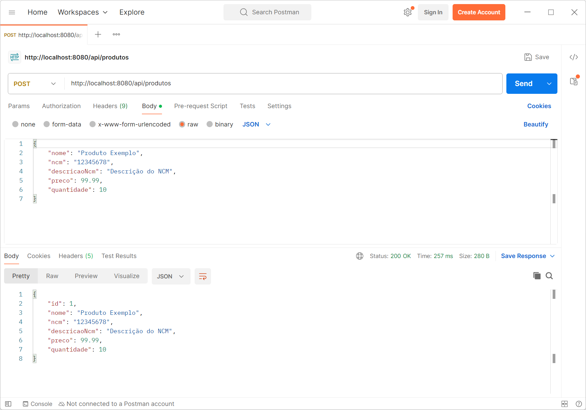


2. **Requisição de Listagem de Produtos**:
   - **Método**: GET
   - **URL**: `http://localhost:8080/api/produtos`
   - **Enviar a Requisição**: clique em "Send" e verifique a resposta. Você deve receber um status 200 OK e uma lista de produtos no corpo da resposta.

        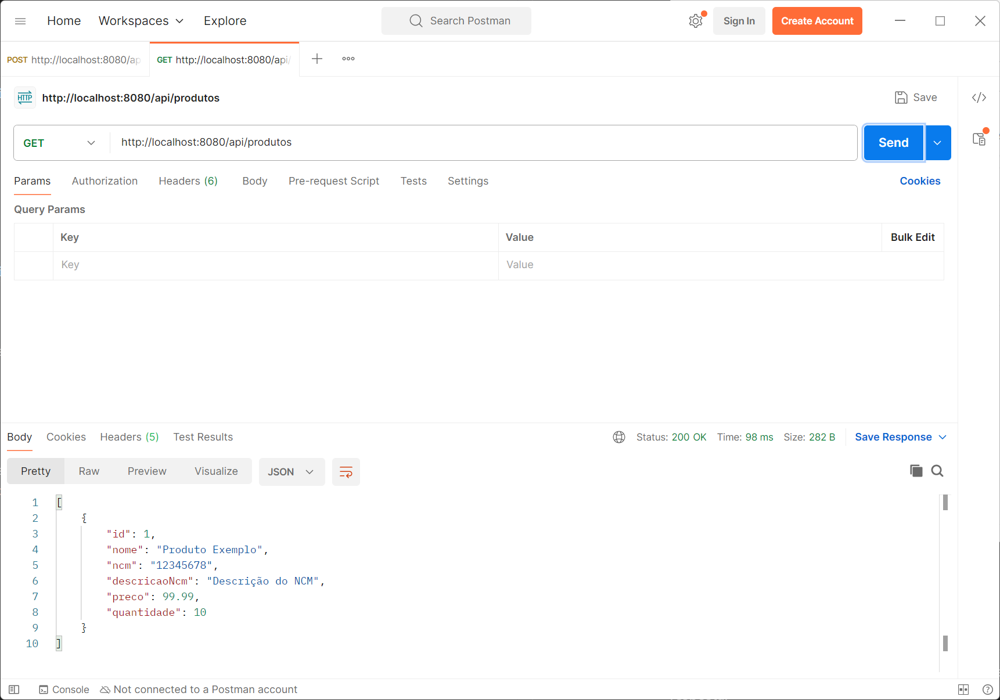   

3. **Requisição de Busca por ID**:
   - **Método**: GET
   - **URL**: `http://localhost:8080/api/produtos/{id}` (substitua `{id}` pelo ID do produto que você deseja buscar).
   - **Enviar a Requisição**: clique em "Send" e verifique a resposta. Você deve receber um status 200 OK e o produto correspondente no corpo da resposta.

        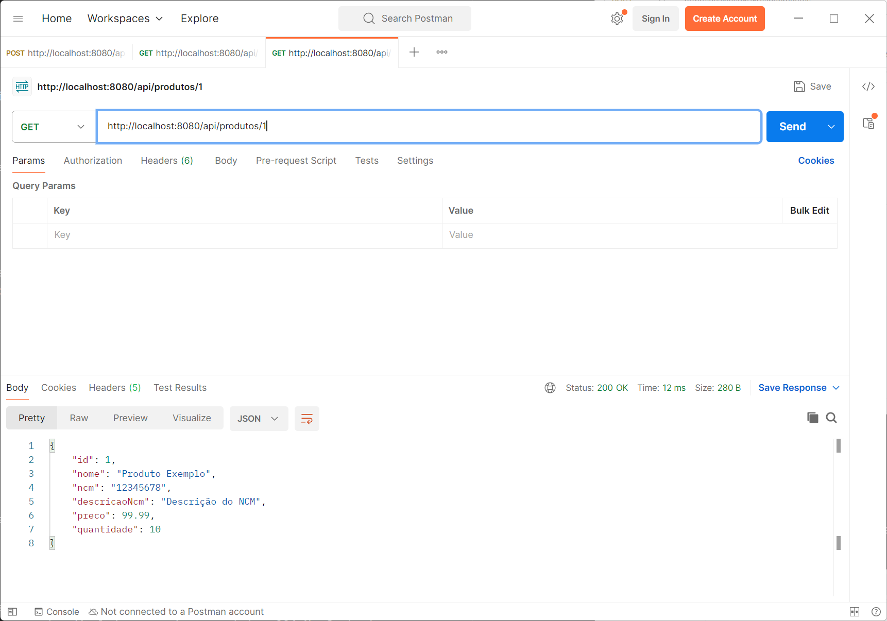

4. **Requisição de Atualização de Produto**:
   - **Método**: PUT
   - **URL**: `http://localhost:8080/api/produtos/{id}` (substitua `{id}` pelo ID do produto que você deseja atualizar).
   - **Headers**: adicione `Content-Type` com o valor `application/json`.
   - **Body**: selecione "raw" e escolha "JSON" no dropdown.
   - **Exemplo de JSON**:
        ```json
        {
            "id": 1,
            "nome": "Produto Atualizado",
            "ncm": "87654321",
            "descricaoNcm": "Descrição do NCM Atualizado",
            "preco": 89.99,
            "quantidade": 5
        }
        ```
    - **Enviar a Requisição**: clique em "Send" e verifique a resposta. Você deve receber um status 200 OK e o produto atualizado no corpo da resposta.

        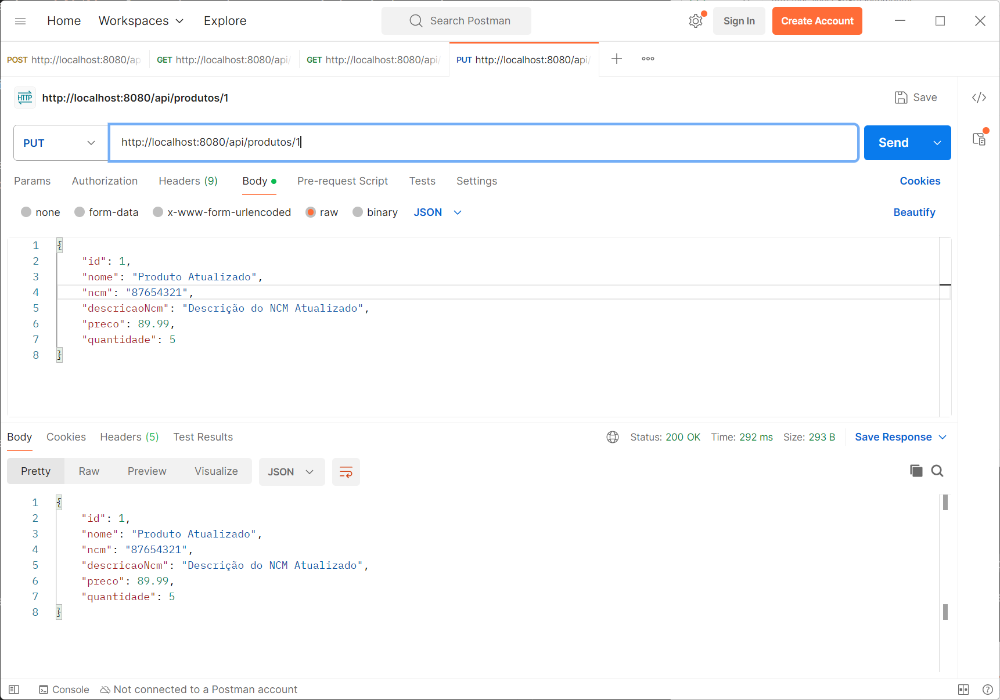


5. **Requisição de Deleção de Produto**:
   - **Método**: DELETE
   - **URL**: `http://localhost:8080/api/produtos/{id}` (substitua `{id}` pelo ID do produto que você deseja deletar).
   - **Enviar a Requisição**: clique em "Send" e verifique a resposta. Você deve receber um status 204 No Content, indicando que o produto foi deletado com sucesso.        

        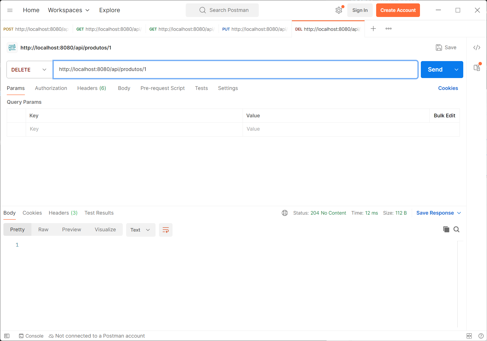


### Roteiro de verificação dos resultados

| Passo | Evidência a conferir |
| --- | --- |
| Criar | Resposta 200 com identificador e os dados enviados |
| Listar | Produto criado presente na coleção; lista vazia também é um resultado válido |
| Buscar | Consulta pelo ID devolve o registro correspondente |
| Atualizar | Nova consulta pelo mesmo ID mostra os valores atualizados |
| Excluir | Resposta 204 sem corpo; a listagem posterior não contém o produto |
| Consultar um ID inexistente | Na versão atual, a exceção genérica não garante 404; observar o erro e discutir seu tratamento futuro |

**Experimentos para discussão:** envie JSON malformado, um ID não numérico e valores de negócio inadequados. Diferencie falha de leitura/conversão da requisição de ausência de validação de negócio. Um preço negativo pode ser aceito pelo código atual: essa observação demonstra um limite da implementação, sem exigir alteração nesta aula.

No PUT, envie todos os atributos que deseja manter. O código recebe uma nova representação da entidade e não faz combinação seletiva com os valores antigos; campos omitidos podem resultar em valores nulos. Na criação, omita o ID para seguir o fluxo esperado de geração pelo banco.

### Parte 6: 🛢️Console Web do H2

O H2 Database é um banco de dados leve e em memória, ideal para desenvolvimento e testes. Ele possui um console web que permite visualizar e manipular os dados armazenados.
Para acessar o console web do H2 Database e visualizar os dados armazenados, siga os passos abaixo:

1. Inicie a aplicação:
2. Acesse a Web Console do H2 Database:

    [http://localhost:8080/h2-console](http://localhost:8080/h2-console) ou abra o navegador e digite:

    ```bash
    http://localhost:8080/h2-console
    ```

3. Configure:

   * **JDBC URL**: `jdbc:h2:mem:produtosdb`
   * **User**: `sa`
   * **Password**: (vazio)

        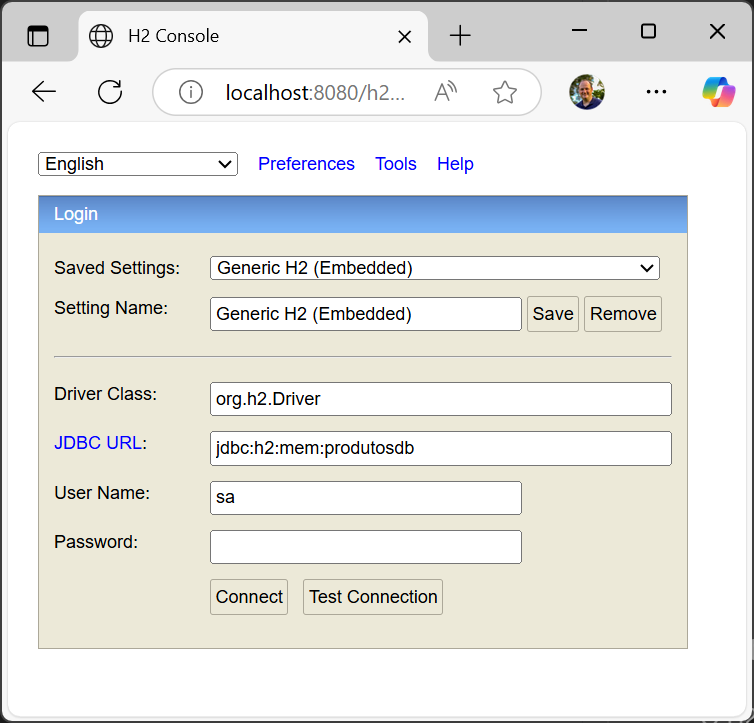

4. Clique em **Connect**.

    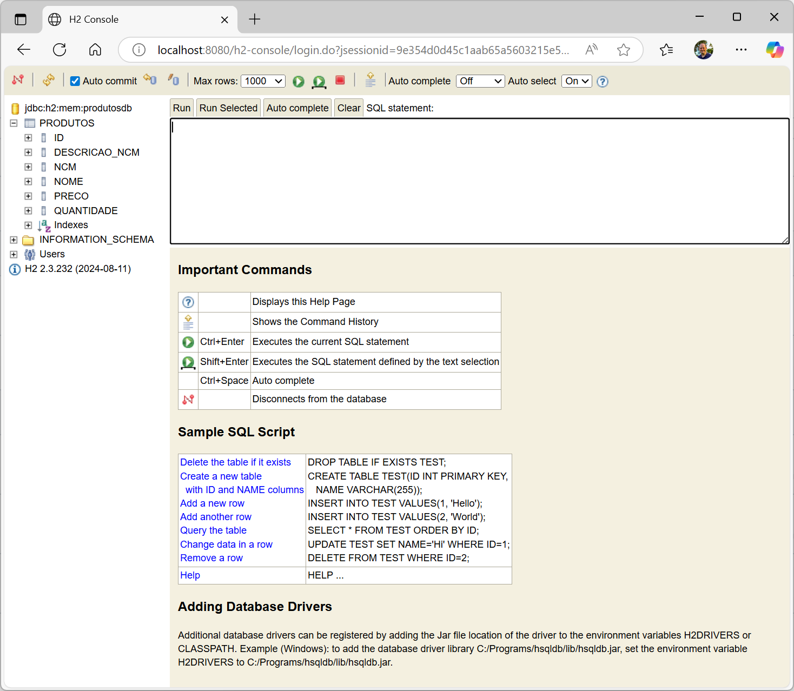

---

### Entendendo a inspeção pelo H2

O console é uma interface de administração do banco; ele não chama `ProdutoController` nem passa pelas regras do serviço. A API demonstra o contrato HTTP, e o console permite conferir a persistência. Alterar dados diretamente ali contorna a aplicação.

**Antes de conectar:** o endereço preservado no passo 3, `jdbc:h2:mem:produtosdb`, corresponde ao exemplo properties. Se estiver utilizando o YAML desta aula, informe `jdbc:h2:mem:testdb`. Os nomes identificam bancos distintos. O console da aplicação deve conectar ao banco em memória disponível no mesmo processo; abrir uma ferramenta externa em outro processo não dá acesso automaticamente à mesma instância apenas por repetir a URL. [10]

Se as tabelas não aparecerem, confira a URL efetiva, os logs de criação do esquema e a configuração carregada. Se `/h2-console` responder 404, confirme se a aplicação iniciou na porta esperada e se `spring.h2.console.enabled` está no nível correto da configuração. Reiniciar a aplicação com o banco em memória exige repetir a criação dos dados.


---


## 📖 Indicação de Leitura para aprendizagem da linguagem Java

* **Java Como Programar**: Livro que aborda conceitos fundamentais de Java, incluindo orientação a objetos, estruturas de controle e manipulação de dados, Paulo Deitel e Harvey Deitel.

    


---

## 📂 Acesso ao Repositório do Projeto

Para acessar o repositório do projeto, clique no link abaixo:

* **Repositório do Projeto**: [GitHub - crud-h2](https://github.com/alonsodecarli-via/crud-h2)

* **Clone o Repositório** usando o comando git abaixo:
    ```bash
    git clone https://github.com/alonsodecarli-via/crud-h2.git
    ```

---

## Referências bibliográficas e documentação

As obras abaixo fundamentam os conceitos, sem pressupor que seus exemplos reproduzam exatamente as versões desta aula. Livros de persistência mais antigos utilizam o namespace `javax.persistence`; no Spring Boot 3, observe a transição para `jakarta.persistence`. Documentações evoluem: consulte a versão correspondente ao projeto.

1. **WALLS, Craig.** *Spring in Action*. 6. ed. Manning, 2022. Referência para Spring Boot, aplicações web, acesso a dados e integração dos componentes. [Página da editora](https://www.manning.com/books/spring-in-action-sixth-edition).
2. **SPILCĂ, Laurențiu.** *Spring Start Here*. Manning, 2021. Leitura para contêiner, beans, contexto, injeção de dependência e fundamentos de aplicações web. [Página da editora](https://www.manning.com/books/spring-start-here).
3. **BLOCH, Joshua.** *Effective Java*. 3. ed. Addison-Wesley, 2018. Apoio para construção de objetos, igualdade, contratos, interfaces e boas práticas da linguagem. [Página da editora](https://www.informit.com/store/effective-java-9780134686097).
4. **FOWLER, Martin.** *Patterns of Enterprise Application Architecture*. Addison-Wesley, 2003. Fundamentação para Service Layer, Repository e organização da persistência. [Catálogo do autor](https://martinfowler.com/eaaCatalog/).
5. **GAMMA, Erich; HELM, Richard; JOHNSON, Ralph; VLISSIDES, John.** *Design Patterns: Elements of Reusable Object-Oriented Software*. Addison-Wesley, 1995. Referência clássica para padrões de projeto, incluindo Builder; os geradores modernos podem utilizar variações desses padrões.
6. **BAUER, Christian; KING, Gavin; GREGORY, Gary.** *Java Persistence with Hibernate*. 2. ed. Manning, 2015. Aprofundamento de ORM, identidade, ciclo de vida de entidades e transações. [Página da editora](https://www.manning.com/books/java-persistence-with-hibernate-second-edition).
7. **MARTIN, Robert C.** *Clean Architecture: A Craftsman's Guide to Software Structure and Design*. Prentice Hall, 2017. Referência para SOLID, fronteiras, responsabilidades e direção das dependências. [Página da editora](https://www.informit.com/store/clean-architecture-a-craftsmans-guide-to-software-structure-9780134494272).
8. **FIELDING, Roy Thomas.** *Architectural Styles and the Design of Network-based Software Architectures*. Tese (Doutorado) — University of California, Irvine, 2000. Fonte original do estilo REST, especialmente o capítulo 5. [Texto do autor](https://ics.uci.edu/~fielding/pubs/dissertation/top.htm).
9. **SPRING.** *Spring Data JPA Reference: Persisting Entities*. Documentação oficial para operações de persistência e identificação de entidades novas. [Documentação](https://docs.spring.io/spring-data/jpa/reference/jpa/entity-persistence.html).
10. **H2 DATABASE.** *Features*. Documentação oficial para modos de conexão, bancos em memória e parâmetros de URL. [Documentação](https://www.h2database.com/html/features.html).
11. **PROJECT LOMBOK.** *Features: @Data, @Builder e construtores*. Documentação oficial sobre geração de código e condições de cada anotação. [Documentação](https://projectlombok.org/features/).
12. **FIELDING, Roy T.; NOTTINGHAM, Mark; RESCHKE, Julian (ed.).** *HTTP Semantics*. RFC 9110. IETF, 2022. Referência normativa para métodos, idempotência, cabeçalhos e respostas HTTP. [RFC 9110](https://www.rfc-editor.org/rfc/rfc9110.html).
13. **SPRING.** *Spring Boot Reference: Structuring Your Code*. Orientações oficiais sobre pacote raiz e descoberta de componentes. [Documentação da linha 3.5](https://docs.spring.io/spring-boot/3.5/reference/using/structuring-your-code.html).
14. **DEITEL, Paul; DEITEL, Harvey.** *Java: como programar*. Pearson. Leitura de apoio para sintaxe, classes, objetos, exceções e coleções; utilize os dados da edição disponível em sua instituição.

**Sugestão de percurso:** retome Java com Deitel; compreenda o contêiner com Spilcă; conecte os recursos de aplicação com Walls; aprofunde persistência com Bauer, King e Gregory; e analise decisões de projeto com Bloch, Fowler, Martin e o GoF. Use Fielding e a RFC 9110 para distinguir arquitetura REST de semântica HTTP.

Bom estudo! 🚀
